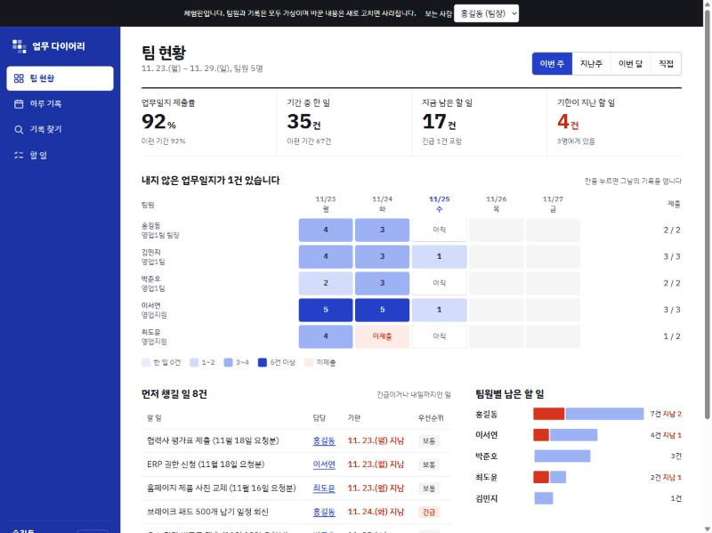
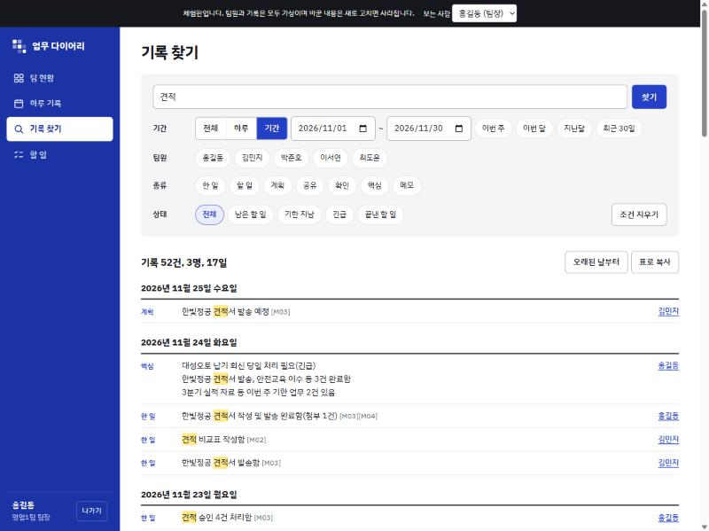
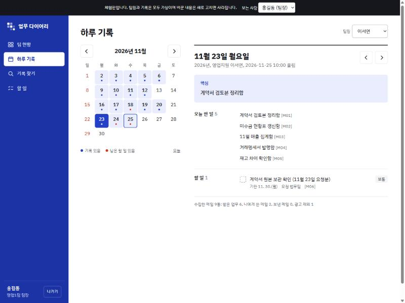

# MVP ② 에이전트 공유 시스템: 팀 업무 다이어리

팀원 각자의 PC에서 MVP ①(일일 업무보고 자동 작성)이 만든 보고서를 **하나의 구글 시트에 모으고**, 웹에서 **팀 현황, 하루 기록, 검색, 할 일**로 봅니다.



| 기록 찾기 | 하루 기록 |
|---|---|
|  |  |

화면의 팀원, 회사, 기록은 모두 가상입니다.

## 1. 요구사항과 구현

| 요구사항 | 구현 |
|---|---|
| 다이어리 화면과 기록 조회 | 달력과 하루 기록, "기록 찾기"에서 **키워드·하루·기간** 검색(팀원·종류·상태 조건 추가) |
| 구글 시트 데이터베이스 | `팀원`, `일지`, `업무기록`, `하루메모` 4개 표 |
| 웹으로 접속 | 구글 Apps Script 웹 앱(무료). 구글 사이트 도구, 노션에 끼워 넣기 가능 |
| 전문적인 디자인 | 업무 시스템형 화면(왼쪽 메뉴, 현황판, 표 중심). 휴대폰과 어두운 화면 지원 |
| 팀원 모두 사용, 한 DB에 집계 | 팀원별 업로드 열쇠로 같은 시트에 저장. 팀장용 **팀 현황**(제출률, 사람×날짜 현황판, 먼저 챙길 일, 남은 일) |

## 2. 전체 흐름

```
팀원 A의 PC  ─ agent ─┐
팀원 B의 PC  ─ agent ─┼─ 개인 업로드 열쇠 ─▶ 구글 Apps Script ─▶ 구글 시트(팀 공용 DB)
팀장의 PC    ─ agent ─┘                            ▲
                                                   │ 개인 접속 코드
                              웹 화면 (팀장: 팀 전체 / 팀원: 자기 기록)
```

agent: 메일 수집 → 광고 제외 → 초안 → 점검 → HTML → (경고 0건일 때만) 업로드

## 3. 시작하기

| 하고 싶은 것 | 방법 |
|---|---|
| 에이전트 내려받기 | **Code > Download ZIP** 또는 `git clone https://github.com/testerMS/mvp2-team-work-diary.git` |
| 화면만 먼저 보기 | 내려받은 `demo/index.html`을 브라우저로 열기 (가상 팀 5명. 위쪽에서 팀장·팀원 화면 전환) |
| 팀장: 웹사이트와 DB 만들기 | [배포안내.md](배포안내.md) |
| 팀원: 내 PC에 설치 | [팀원_설치안내.md](팀원_설치안내.md) |

## 4. 팀으로 쓸 때의 규칙

| 규칙 | 구현 |
|---|---|
| 남의 이름으로 올릴 수 없음 | 기록의 주인은 적어 보낸 이름이 아니라 열쇠로 정함 |
| 서로의 기록을 덮어쓰지 않음 | 같은 날을 다시 올리면 자기의 그날 기록만 바뀜. 동시에 올리면 차례로 저장하고 바쁘면 다시 시도 |
| 볼 수 있는 범위 | 팀원은 자기 것, 팀장은 팀 전체. 메뉴에서 **팀원끼리 보기**를 켤 수 있음 |
| 완료 표시, 컨디션, 메모 | 본인만 바꾸고, 컨디션·메모는 화면에서 본인만 봄 |
| 제출률 | 사용 중인 팀원 × 평일(등록일 이후, 어제까지) 중 낸 비율. 오늘은 낸 사람만 셈 |

## 5. 데이터베이스 구조

| 표 | 한 줄의 의미 | 주요 열 |
|---|---|---|
| 팀원 | 한 사람 | 팀원ID, 이름, 부서, 역할, 상태, 등록일 |
| 일지 | 한 사람의 하루 | 날짜, 작성자, 핵심, 건수, 업로드 시각, 팀원ID |
| 업무기록 | 업무 1건 | 기록ID, 날짜, 구분, 내용, 요청자, 기한, 우선순위, 상태, 팀원ID, 이름 |
| 하루메모 | 한 사람의 하루 메모 | 날짜, 기분, 메모, 팀원ID |

## 6. 폴더 구조

```
work-diary/
├── README.md, 배포안내.md(팀장), 팀원_설치안내.md
├── web/            구글에 붙여 넣는 파일 2개 (Code.gs, Index.html)
├── agent/          MVP ① 에이전트 + join_team.py(팀원 설정) + scripts/publish_diary.py(업로드)
├── demo/           체험판과 만드는 스크립트
├── docs/           화면 예시
└── tests/          자동 시험, 내 PC에서 돌려 보는 시험 서버
```

## 7. 보안과 개인정보

| 항목 | 처리 |
|---|---|
| 올리지 않는 것 | 메일 원문, 광고 제외 목록, 메일 비밀번호 |
| 열쇠와 코드 | 사람마다 다름. 서버에는 해시만 저장. 업로드 열쇠로 로그인하거나 그 반대는 불가 |
| 로그인 | 10번 틀리면 그 사람만 10분 잠김, 6시간 뒤 자동 로그아웃 |
| 퇴사·이동 | 상태를 `중지`로 바꾸면 로그인과 업로드가 바로 막힘 |
| 시트·화면 | 내용이 수식이나 스크립트로 실행되지 않게 처리 |

## 8. 시험 결과

```bash
node --test tests/test_web.js      # DB, 검색, 로그인, 팀 권한 29개 (Node.js 필요)
python tests/test_publish.py       # 업로드, 팀원 설정 17개 (Node.js 필요)
python agent/evals/test_agent.py   # MVP ① 20개
```

모두 통과 (2026. 11. 25., Windows 11, Python 3.13, Node 26). 브라우저에서 팀장·팀원 로그인, 팀 현황, 검색, 완료 체크, 메모, 어두운 화면, 휴대폰 화면(375px)을 확인했습니다.

## 9. 한계

- 구글 시트는 흉내 낸 시험 환경에서 확인했습니다. **실제 구글 계정 배포는 아직 확인 전**입니다.
- 시트 파일을 열 수 있는 사람은 권한과 관계없이 모든 기록과 메모를 볼 수 있습니다. 시트를 팀원에게 공유하지 않습니다.
- 이름은 가리지 않고 올라갑니다. 회사의 클라우드·개인정보 규정을 확인해 주세요.
- 조회할 때마다 시트를 모두 읽습니다. 10명이 1년 쓰면 수만 줄이 되어 느려질 수 있으니 해마다 새 시트로 나누는 것을 권합니다.
- 공휴일과 휴가는 구분하지 않아 제출률에서 미제출로 셉니다.
- 매일 자동 실행은 넣지 않았습니다. 올리기 전에 사람이 확인하도록 했습니다.
